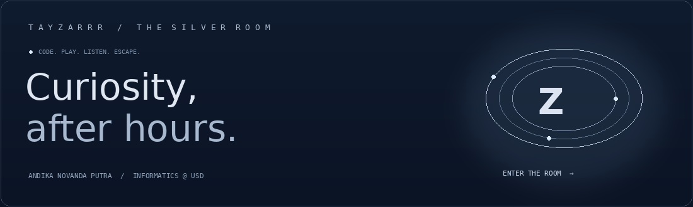
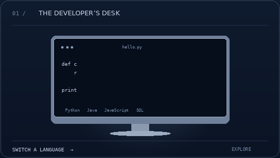
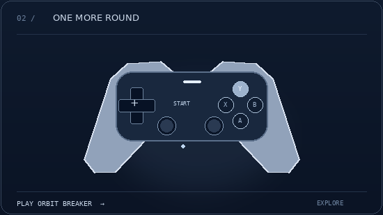
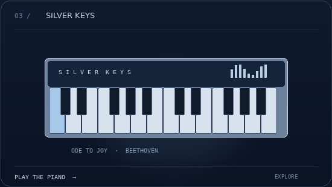
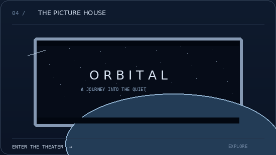

<div align="center">

[](https://tayzarrr.github.io/Tayzarrr/)

**Andika Novanda Putra** · Informatics @ Universitas Sanata Dharma

Software development, cryptography & computer vision.<br>
Off duty: games, cinema, jazz, R&B, and piano.

[**ENTER THE INTERACTIVE ROOM ↗**](https://tayzarrr.github.io/Tayzarrr/)

<sub>Navy & silver. Four interests. One universe.</sub>

</div>

---

<table>
<tr>
<td width="50%" align="center"><a href="https://tayzarrr.github.io/Tayzarrr/#code"></a><br><a href="https://tayzarrr.github.io/Tayzarrr/#code"><b>Code & create ↗</b></a><br><sub>Switch languages. Explore the terminal.</sub></td>
<td width="50%" align="center"><a href="https://tayzarrr.github.io/Tayzarrr/#arcade"></a><br><a href="https://tayzarrr.github.io/Tayzarrr/#arcade"><b>Ready, player one? ↗</b></a><br><sub>A playable arcade. Your controller. Your score.</sub></td>
</tr>
<tr>
<td width="50%" align="center"><a href="https://tayzarrr.github.io/Tayzarrr/#music"></a><br><a href="https://tayzarrr.github.io/Tayzarrr/#music"><b>Find your rhythm ↗</b></a><br><sub>Play the piano. Let the melody take over.</sub></td>
<td width="50%" align="center"><a href="https://tayzarrr.github.io/Tayzarrr/#cinema"></a><br><a href="https://tayzarrr.github.io/Tayzarrr/#cinema"><b>Beyond the screen ↗</b></a><br><sub>Orbital. Nocturne. Horizon. Pick your escape.</sub></td>
</tr>
</table>

<div align="center"><sub>GIF previews animate here. Click an object to open the playable experience.<br>Piano audio starts after you press a key or Play melody in the room.</sub></div>

### Selected work

| Project | Exploration |
| :--- | :--- |
| [CryptoDES ↗](https://github.com/Tayzarrr/CryptoDES) | DES & Triple DES · manual implementation + PyCryptodome |
| [CryptoZar ↗](https://github.com/Tayzarrr/CryptoZar) | Encryption & decryption application |
| [Galaxy ↗](https://github.com/Tayzarrr/Galaxy) | Hand gestures · 3D particle experience |
| [PDA.ID ↗](https://github.com/Tayzarrr/PDA.ID) | Cinema ticket booking website |
| [PENUSA ↗](https://github.com/Tayzarrr/PENUSA) | Vacation package booking website |
| [Kalkulator ↗](https://github.com/Tayzarrr/Kalkulator) | A simple web calculator |

<details>
<summary><b>Open the developer's log</b></summary>

```python
class Tayzarrr:
    based_in = "Yogyakarta, Indonesia"
    learning = ["Software Development", "Computer Vision", "Cryptography"]
    tools = ["Python", "Java", "JavaScript", "HTML", "CSS", "SQL", "Git"]
    soundtrack = ["Jazz", "R&B", "Piano"]
    worlds = ["Action", "Open-world", "RPG"]
    mindset = "Curiosity has no closing time."
```

</details>

---

<div align="center">

**Curiosity has no closing time.**

[The room ↗](https://tayzarrr.github.io/Tayzarrr/) · [Repositories ↗](https://github.com/Tayzarrr?tab=repositories)

<sub>TAYZARRR / THE SILVER ROOM</sub>

</div>
